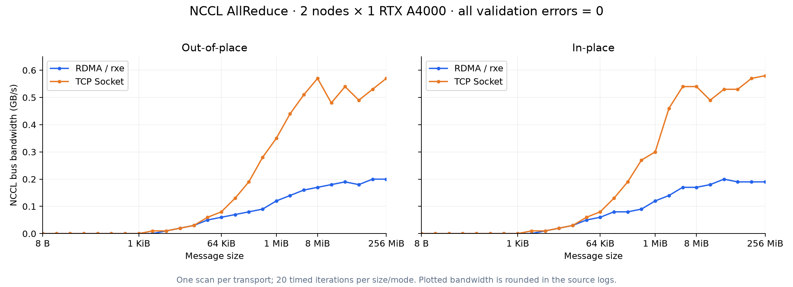
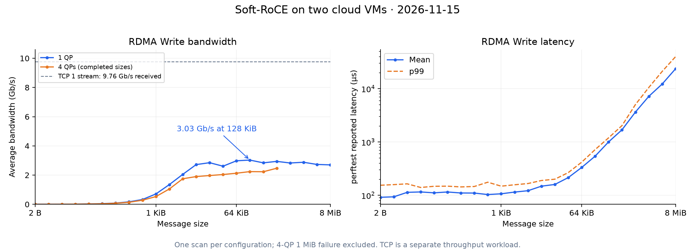
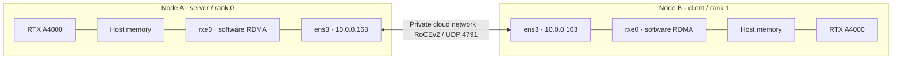

# Soft-RoCE RDMA & NCCL Lab

[](LICENSE)

Two cloud GPU VMs, a software RoCEv2 link, and an evidence trail from verbs to NCCL AllReduce.

This lab connects two Linux VMs with **Soft-RoCE (`rdma_rxe`)**, verifies the transport with packet headers and NCCL logs, and compares software RDMA with TCP on the same pair of machines. The recorded run completed on **November 15, 2026**.

**Result:** Soft-RoCE passed end-to-end validation; TCP delivered higher throughput on this platform. NCCL used `NET/IB` over `rxe0` with zero validation errors. Single-stream TCP throughput was about **3.2×** the highest per-size average RDMA Write throughput; at 256 MiB, out-of-place NCCL Socket busbw was **2.85×** RDMA busbw. These observations come from one experimental session, with the original failures retained.

[Results](results/README.md) · [Reproduction guide](docs/reproduce.md) · [Evidence and corrections](docs/evidence.md) · [中文实验报告](docs/report-zh.md)

## Measured results

| Workload | Observed result | Source |
|---|---|---|
| RDMA CM connectivity | 10 `rping` exchanges completed | [Client log](data/raw/node-b/rping_client.txt) |
| RC pingpong | 4 KiB messages; 327.03 µs per round-trip iteration | [Client log](data/raw/node-b/rc_pingpong_client.txt) |
| RDMA Write, 1 QP | Highest per-size average **3.03 Gb/s** at 128 KiB | [Client scan](data/raw/node-b/ib_write_bw_client.txt) |
| RDMA Write latency | **91.87 µs mean** at 2 B; **333.30 µs** at 64 KiB | [Client scan](data/raw/node-b/ib_write_lat_client.txt) |
| TCP, 30 s | **9.76 Gb/s received** with 1 stream; **10.7 Gb/s** with 4 streams | [1 stream](data/raw/node-b/iperf3_1stream.txt), [4 streams](data/raw/node-b/iperf3_4stream.txt) |
| NCCL AllReduce, 256 MiB, out-of-place | **0.20 GB/s** busbw via RDMA; **0.57 GB/s** via Socket | [RDMA](data/raw/node-a/nccl_allreduce_rdma.txt), [Socket](data/raw/node-a/nccl_allreduce_socket.txt) |
| NCCL AllReduce, reported scan-average busbw | **0.077 GB/s** via RDMA; **0.205 GB/s** via Socket | [Summary](results/nccl_summary.json), [Full CSV](results/nccl_allreduce.csv) |
| NCCL validation | Both transports: all `#wrong` counts zero; `Out of bounds values : 0 OK` | Same NCCL logs |

`Gb/s` means gigabits per second; `GB/s` means gigabytes per second. Sizes use binary units (`KiB`, `MiB`). RDMA Write and iperf3 exercise different APIs and workloads; their throughput comparison is contextual. The 3.2× baseline ratio uses single-stream iperf3 receive throughput (9.76 Gb/s) and the highest per-size average RDMA Write throughput (3.03 Gb/s). The 2.85× NCCL ratio uses printed busbw values (0.57 / 0.20) for the same collective, size, and buffer mode. The reported scan averages combine 26 message sizes (8 B–256 MiB) and both buffer modes; they are not averages across independent runs.





## Topology and environment



GPUDirect RDMA was disabled. GPU transfers used host staging. TCP/IP was also used for connection setup and MPI/bootstrap traffic.

| Component | Recorded configuration |
|---|---|
| Platform | Hyperstack NORWAY-1; 2 VMs, each reported as 4 vCPU / 21 GB RAM |
| GPU | 1 NVIDIA RTX A4000 per node; driver 570.195.03 |
| OS / kernel | Ubuntu 24.04 packages; `6.14.0-37-generic` |
| RDMA / perftest | rdma-core `50.0-2ubuntu0.2`; perftest `24.01.0+0.38-1build2` |
| Soft-RoCE | `rxe0`, Ethernet link layer; reported active MTU 4096; IPv4 RoCEv2 GID index 1 |
| CUDA / NCCL | CUDA toolkit 12.8; runtime NCCL `2.32.6+cuda12.9` |
| MPI / nccl-tests | OpenMPI 4.1.6; nccl-tests 2.21.1, revision [`afd59ab`](https://github.com/NVIDIA/nccl-tests/commit/afd59abab774a6a4b492eb344bd0c845a0b7bb4d) |

The cloud sizing/region comes from the operator's experiment notes. The raw logs substantiate the GPU and software versions. Early package snapshots show the initial CUDA 13.5 NCCL build; [package replacement logs](data/raw/node-a/apt_nccl_swap_brilliant-franklin.txt) and the successful NCCL logs show the final CUDA 12.9 build. The NIC's Ethernet MTU was not archived; the reported RDMA active MTU is a different field.

## Transport evidence

Both ranks explicitly selected the software RDMA interface:

```text
NET/IB : Using [0]rxe0:1/RoCE
Using network IB
Channel 00/0 : 0[0] -> 1[0] [send] via NET/IB/0
NET/IB : GPU Direct RDMA Disabled for HCA 0 'rxe0'
```

The control run selected `Using network Socket` and `via NET/Socket/0` instead. See the complete [RDMA](data/raw/node-a/nccl_allreduce_rdma.txt) and [Socket](data/raw/node-a/nccl_allreduce_socket.txt) outputs.

The separate [packet capture](data/raw/node-a/roce_v2.pcap) contains **200 Ethernet/IPv4/UDP frames**, 100 in each direction, with UDP destination port 4791. Its BTH headers contain RC SEND first/middle/last packets and ACKs. The capture demonstrates RoCEv2 traffic in this lab; it is not a packet trace of every benchmark. [Decoded counts](results/capture_summary.json)

## Inspect the results locally

No GPU or Linux kernel module is needed for analysis:

```bash
git clone https://github.com/sxwangsxwang1/softroce-rdma-nccl-lab.git
cd softroce-rdma-nccl-lab
python3 analysis/summarize.py --check
python3 -m unittest discover -s tests -v
```

To regenerate CSV/JSON tables and figures:

```bash
python3 analysis/summarize.py
python3 -m venv .venv
source .venv/bin/activate
python -m pip install -r requirements.txt
python analysis/plot.py
```

The table parser uses Python 3.10+ and its standard library; figure generation requires Python 3.11+. **The original two-node experiment, including both NCCL transport runs, was completed and is documented above.** The helpers under [`scripts/`](scripts/) were added during publication from the recorded commands and notes, then checked locally. These exact helper versions have not been used to repeat the cloud experiment; that describes their verification status, not an unfinished experiment step. See the [two-node guide](docs/reproduce.md) before running them.

## Findings and limits

- **Soft-RoCE worked end to end; TCP was faster in this session.** Verbs connectivity, RoCEv2 packet headers, NCCL transport logs, and zero validation errors establish functionality. The throughput comparisons above show the performance gap for these workloads and this configuration.
- **Software RDMA had substantial CPU cost.** Aggregate CPU samples support that observation, but lack timestamps and process attribution. They do not establish a unique bottleneck or a per-process core budget. [CPU samples](results/figures/cpu_samples.png)
- **More QPs did not improve the completed overlapping sizes.** The 4-QP scan failed at 1 MiB with completion status 5 (`IBV_WC_WR_FLUSH_ERR`). Its last row is excluded from successful measurements; the initiating failure is unresolved.
- **This is a single-session study.** One scan per configuration, no independent repetitions or confidence intervals, no CPU affinity controls, and no archived NIC offload settings. The NCCL scans used 20 timed iterations per size and buffer mode.
- **Scope:** two nodes, software RDMA, and host-staged GPU communication. Hardware RoCE performance, GPUDirect RDMA performance, PFC/ECN/DCQCN, and larger-cluster scaling were not measured.

## Repository map

```text
analysis/       Raw-log parsing, integrity verification, and plotting
data/raw/       44 unmodified files, separated by node
data/manifest.json  SHA-256 hashes and original archive/member names
docs/           Reproduction, evidence notes, and Chinese report
results/        Derived CSV/JSON tables, summaries, and PNG/SVG figures
scripts/        Reconstructed setup/build/run helpers
tests/          Checks for interleaved logs, failed runs, and capture contents
```
